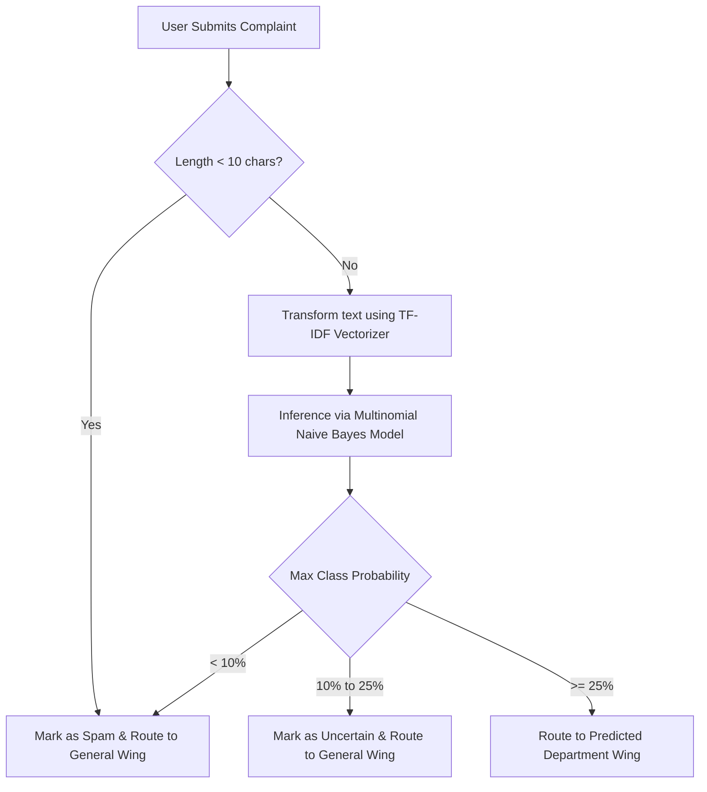

# Civic Resolve - Intelligent Complaint Routing

Civic Resolve is a premium, state-of-the-art campus maintenance complaint management system. By leveraging machine learning models, it automates ticket routing, detects spam, and handles ambiguous complaints to streamline operations for students, faculty, and maintenance staff alike.

[](https://flask.palletsprojects.com/)
[](LICENSE)

---

## 🚀 Key Features

*   **🔮 Intelligent Routing:** Uses a Multinomial Naive Bayes model to automatically categorize and route incoming tickets to the appropriate department (e.g., Electrical, Plumbing, Carpentry).
*   **🛡️ Spam & Noise Filtering:** Automated triage instantly identifies junk inputs or extremely short descriptions, assigning them to the general review queue.
*   **⚠️ Uncertainty Triage:** Tickets with low prediction confidence (e.g., between 10% and 25%) are flagged as **Uncertain** and routed to **General** to ensure human review.
*   **👥 Multi-Role Dashboards:** Dynamic, secure portals for Students, Faculty, and Maintenance Staff with status updates, priorities, and real-time logs.
*   **🎨 Premium UI:** Crafted using modern CSS styling featuring glassmorphism, responsive grids, and subtle micro-animations.

---

## 📊 Intelligent Routing Flow

The routing pipeline automates the ticket assignment process:



---

## 📂 Project Directory Structure

```text
Civic-Resolve-Intelligent-Complaint-Routing/
├── .gitignore                       # Git ignore specifications
├── docs/                            # Project documentation markdowns
│   ├── architecture.md              # System architecture & database schema details
│   ├── ml_model.md                  # ML routing model details & thresholds
│   └── setup.md                     # Local system setup & database config instructions
├── media/                           # Project media, poster and presentation decks
│   ├── CivicResolve_A1Poster.pdf    # Project poster
│   ├── CivicResolve_PitchDeck.pptx  # Pitch deck presentation
│   └── gallery/                     # Image gallery
├── project/                         # Source code directory
│   ├── .env.example                 # Example configuration template file for database/secrets
│   ├── app.py                       # Main application controller & ML routing inference
│   ├── auth.py                      # MySQL-backed session authentication & RBAC middleware
│   ├── model.ipynb                  # ML Model notebook for training, evaluation & export
│   ├── model.pkl                    # Serialized Multinomial Naive Bayes classifier
│   ├── multi_app_launcher.py        # Helper script for running multi-role sessions
│   ├── vectorizer.pkl               # Serialized TF-IDF text vectorizer (1-2 n-grams)
│   ├── data/
│   │   ├── complaints.csv           # Seed data & model training dataset
│   │   ├── users.csv                # Seed user accounts
│   │   └── sql/                     # SQL initialization scripts
│   │       ├── users.sql            # Users schema & CSV import script
│   │       ├── complaints.sql       # Complaints schema & CSV import script
│   │       └── syslogs.sql          # System audit logs schema
│   ├── static/
│   │   └── assets/                  # Project media and UI styling assets
│   │       ├── css/                 # Stylesheets for layouts, pages & themes (auth-pages.css, dashboard.css)
│   │       ├── images/              # Branding & media assets (sau-white-logo.png)
│   │       └── js/                  # Client-side scripts & animations (auth-waves.js, cache-guard.js, dashboard.js)
│   └── templates/
│       ├── dashboard/               # Base layout and role-specific dashboards
│       │   ├── admin/               # Superadmin view (index.html)
│       │   ├── staff/               # Maintenance staff view (index.html)
│       │   ├── users/               # Student/Faculty view (index.html)
│       │   └── base_dashboard.html  # Shared dashboard template
│       ├── invalid-login/           # Error & fallback triage portal (index.html)
│       └── login/                   # Multi-role landing & portal pages
│           ├── maintenance/         # Maintenance staff login page (index.html)
│           ├── users/               # Student/Faculty login page (index.html)
│           └── index.html           # Main role-selection landing page
└── requirements.txt                 # Python dependency specifications
```

---

## 📂 Documentation Quick Links

Explore detail-oriented guides for every aspect of the project:

*   📖 **[Setup & Installation Guide](docs/setup.md)** - Get up and running in a few simple steps.
*   🏛️ **[System Architecture](docs/architecture.md)** - Technical system overview, project files, and database design.
*   🧠 **[Machine Learning Integration](docs/ml_model.md)** - Deep dive into TF-IDF Vectorization, Naive Bayes, and custom decision boundaries.

---

## 🛠️ Quick Start

### 1. Clone & Navigate
```bash
# Clone the repository
git clone https://github.com/MukundXplore/Civic-Resolve-Intelligent-Complaint-Routing.git

# Navigate to the project directory
cd Civic-Resolve-Intelligent-Complaint-Routing/project
```

### 2. Dependency Setup
```bash
# Install required libraries
pip install -r requirements.txt
```

### 3. Run Application
```bash
# Start the local development server
python app.py
```
Open your browser and navigate to `http://localhost:5000` to start exploring.

---

## 👥 Contributors

We are a team of passionate developers dedicated to improving campus infrastructure through technology.

| Contributor | Profile |
| :--- | :--- |
| **Mukund Prasad** | [mukundxplore](https://github.com/mukundxplore) |
| **Farhan Akhlaq** | [wanderingCoder95](https://github.com/wanderingCoder95) |
| **Misbah Ul Islam** | [misbahGitPilot44](https://github.com/misbahGitPilot44) |
| **Karthik Baurai** | [KarthikBaurai](https://github.com/KarthikBaurai) |

---
*Developed for Case Study Mini-Project.*