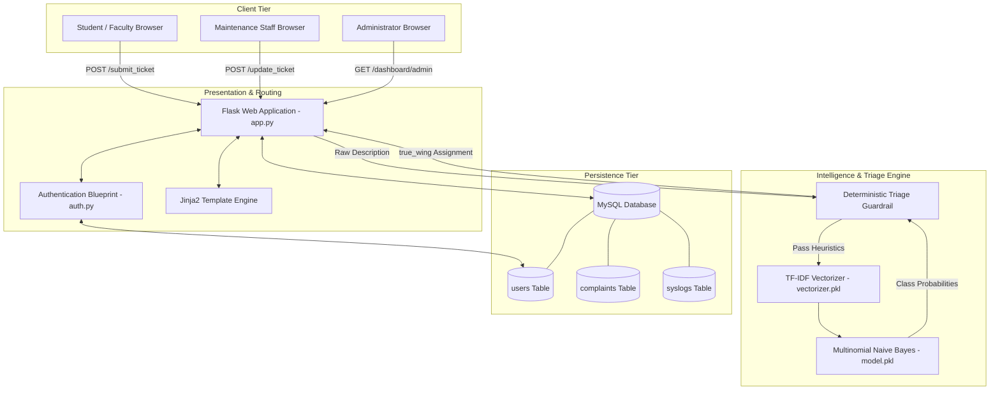
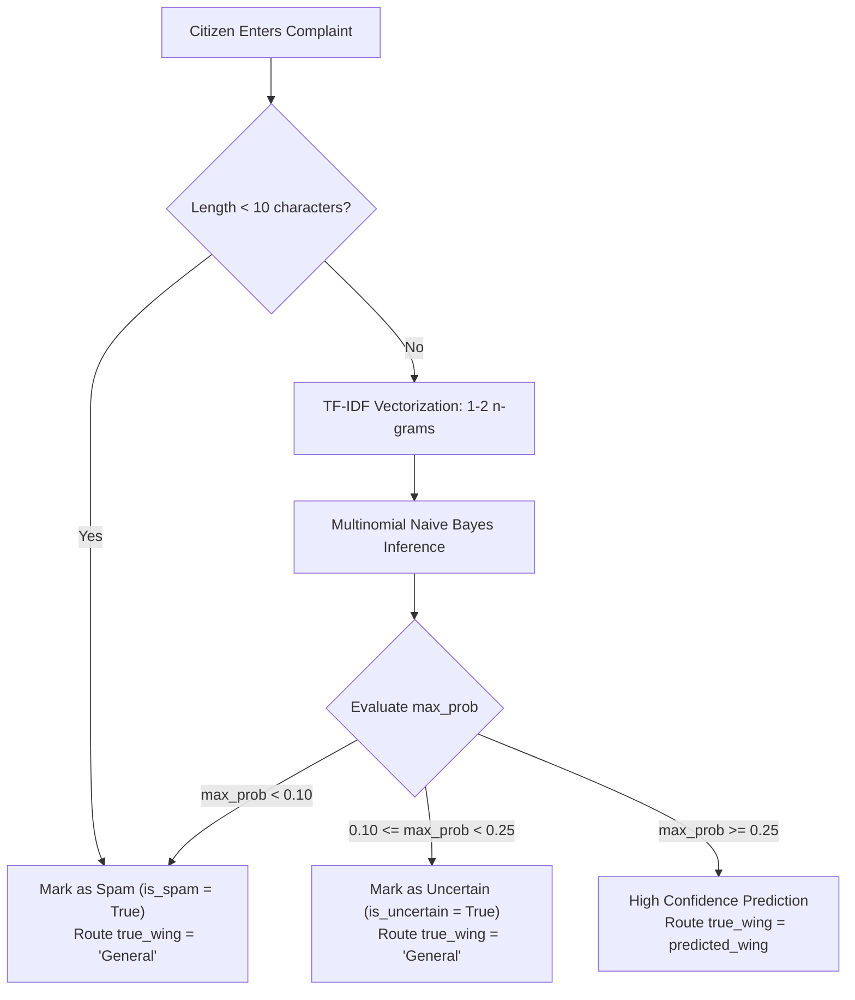
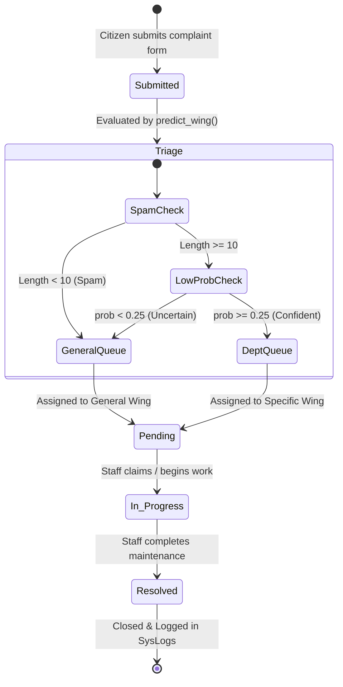

# Project Samadhan — Civic Resolve: Intelligent Complaint Routing
### Academic Software Engineering Capstone — South Asian University

[](https://flask.palletsprojects.com/)
[](#-software-engineering-lifecycle--methodology)
[](#)
[](LICENSE)

---

## 🏛️ Project Overview

**Project Samadhan** (originally initiated as *Civic Resolve*) is an intelligent campus maintenance grievance management and automated routing platform designed and developed at the **Department of Computer Science, South Asian University**.

The platform automates the triage and assignment of maintenance complaints submitted by students and faculty using Natural Language Processing (TF-IDF vectorization and a Multinomial Naive Bayes classifier). It eliminates manual routing delays, rejects low-quality/spam inputs, routes ambiguous complaints to human supervisors, and provides role-based tracking portals for campus citizens, maintenance staff, and administrative leadership.

The project follows an iterative **Evolutionary Prototyping** Software Development Life Cycle (SDLC) transitioning from an integrated working prototype (Iteration 1, April–May 2026) to a formal, hardened software engineering deliverable suite (Iteration 2, June–November 2026).

---

## 🚨 Problem Statement & Objectives

### The Campus Grievance Bottleneck
In conventional university campuses and residential institutions:
1. **Manual Registers & Fragmented Channels:** Complaints are recorded in paper registers, scattered WhatsApp groups, or informal phone calls, creating tracking black holes.
2. **High Misrouting Latency:** Students cannot accurately classify technical infrastructure failures (e.g., distinguishing plumbing leaks from masonry or electrical duct issues). Complaints bounce between departments for days before reaching the appropriate technician.
3. **No Accountability or Real-Time Audit:** Lack of status transparency breeds student dissatisfaction, while administrators have no verifiable audit logs of maintenance turnaround times.
4. **Spam & Vague Noise:** Submissions such as "help", "broken", or random keystrokes clutter staff queues without actionable detail.

### Core Objectives
*   **Natural Language Complaint Intake:** Allow citizens to express complaints in everyday language without requiring them to know institutional department structures.
*   **Probabilistic Routing with Heuristic Guardrails:** Route clear complaints directly to maintenance wings (Electrical, Plumbing, Carpentry, Sanitation, Masonry).
*   **Spam & Uncertainty Triage:** Intercept short or low-confidence submissions and divert them to a shared `General` queue for human supervisor triage.
*   **Full Accountability & Dual-Label State Tracking:** Separate user-facing predicted wings from internal routing reality to preserve transparent audit trails.
*   **Defensive UI & Session Security:** Provide multi-role web dashboards protected by MySQL session authentication and client-side cache guards.

---

## 👥 Stakeholder Roles & Access Control

The platform enforces three distinct stakeholder access tiers:

| Stakeholder Role | Typical Actors | Responsibilities & Capabilities |
| :--- | :--- | :--- |
| **Citizens (Users)** | Students, Research Scholars, Faculty, Hostel Residents | • Submit complaints via natural language form<br>• View real-time status (`Pending` ➔ `In Progress` ➔ `Resolved`)<br>• View assigned wing, location, and filing timestamps<br>• Access filtered personal ticket history |
| **Maintenance Staff** | Department technicians (Electrical, Plumbing, Carpentry, etc.) | • View tickets assigned to their specific department wing<br>• View all tickets diverted to the `General` triage queue<br>• Update complaint progress and mark issues as resolved<br>• View aging ticket alerts (tickets unresolved > 3 days) |
| **Administrators (Superadmin)** | Estate Officer, Chief Warden, Campus Maintenance Supervisor | • Global oversight across all wings and campus locations<br>• Full complaint distribution charts and performance metrics<br>• Access to real-time `SysLogs` audit trails<br>• Management of staff department assignments and accounts |

---

## 💻 Technical Stack

```
Frontend Tier       : HTML5, Modern CSS3 (Glassmorphism, CSS Variables, Flexbox/Grid), JavaScript
Templating Engine   : Jinja2 (Inherited layouts, base_dashboard.html, role-specific index pages)
Application Backend : Python 3.14 / Flask 3.1.2 (Microframework Monolith)
Session & Auth      : Flask Session with custom Blueprint (auth.py) & client-side cache guard
Database Storage    : MySQL 8.x / mysql-connector-python (Relational tables: users, complaints, syslogs)
Machine Learning    : scikit-learn 1.8.0 (Multinomial Naive Bayes Classifier)
Feature Extraction  : scikit-learn TF-IDF Vectorizer (Unigrams & Bigrams, sublinear TF scaling)
Serialization       : Python joblib / pickle (model.pkl, vectorizer.pkl)
Environment Mgmt    : python-dotenv (.env.example for database & secret configuration)
```

---

## 🏗️ System Architecture & Dataflow

Samadhan is designed as a **Lightweight Modular Monolith** with a clear separation of concerns across authentication, application controllers, database persistence, and ML inference:



---

## 🔮 Machine Learning Classification & Triage Logic

### 1. Dual-Label State Machine (`wing` vs. `true_wing`)
To prevent automated decisions from confusing users or silently misrouting edge cases, Samadhan implements a **dual-label routing architecture**:
- `predicted_wing` / `wing`: The department inferred by the ML model (or default heuristic), visible to the user as feedback.
- `true_wing` / `db_wing`: The actual internal routing target in MySQL. If the ticket is flagged as **Spam** or **Uncertain**, `true_wing` is set to **`General`**, making the ticket visible to all maintenance staff and supervisors for manual triage.

### 2. Probabilistic Decision Boundaries
The intake pipeline in `project/app.py` enforces three deterministic gates:



*Example running test case:*
> Input: *"There is a leaking pipe near room 302 causing flooding."*  
> Inference: `predicted_wing` = `Plumbing` ($P > 0.85$).  
> Action: `true_wing` = `Plumbing`, `is_spam` = `False`, `is_uncertain` = `False`. Instant assignment.

---

## 🔄 Complaint Lifecycle

Every maintenance complaint in Samadhan transitions across a deterministic state machine:



---

## 📂 Software Engineering Deliverables Suite

All formal academic deliverables for the South Asian University Software Engineering capstone are maintained under the dedicated [`Samadhan-SoftwareEngineering/`](Samadhan-SoftwareEngineering/) directory:

| Deliverable Artifact | Format | Description & Scope |
| :--- | :---: | :--- |
| **[SE Documentation](Samadhan-SoftwareEngineering/Samadhan%20-%20CivicResolve%20-%20SE%20Documentation.pdf)** | PDF (118 pages) | Comprehensive IEEE 830 SRS, Evolutionary Prototyping process model, architectural compliance review, formal test suite, Requirements Traceability Matrix (RTM), change management log, and release readiness. |
| **[System Diagrams](Samadhan-SoftwareEngineering/Diagrams.pdf)** | PDF (10 pages) | Complete architectural and design models: Use Case Diagram, Class Diagram, Sequence Models, Activity Diagrams, Statechart, and Database ER Diagram. |
| **[Pitch Presentation](Samadhan-SoftwareEngineering/Project%20Samadhan%20-%20Pitch.pdf)** | PDF (18 slides) | Capstone evaluation pitch deck covering the problem, technical architecture, running "leaking-pipe" demo scenario, and future scaling vision. |
| **[Slide-wise Speaking Script](Samadhan-SoftwareEngineering/5_Minute_Slidewise_Script.docx)** | DOCX (30 paragraphs) | Timed 5-minute defense script (4 presenters, 18 slides) maintaining strict academic integrity. |
| **[SE Academic README](Samadhan-SoftwareEngineering/README.md)** | Markdown | Academic overview indexing team lifecycle contributions, slide breakdown, and deliverable catalogs. |

---

## 📁 Repository Directory Structure

```text
Civic-Resolve-Intelligent-Complaint-Routing/
├── .gitignore                                 # Git ignore specifications (caches, environments, bundles)
├── README.md                                  # Master repository documentation (this file)
├── requirements.txt                           # Python package dependencies
├── docs/                                      # Technical implementation documentation
│   ├── architecture.md                        # Architectural design & database schema
│   ├── ml_model.md                            # ML routing boundaries & probability thresholds
│   └── setup.md                               # Step-by-step local setup guide
├── media/                                     # Exhibition collateral
│   ├── CivicResolve_A1Poster.pdf              # Academic exhibition poster
│   ├── CivicResolve_PitchDeck.pptx            # Presentation slides
│   └── gallery/                               # UI screenshots and visual assets
├── Samadhan-SoftwareEngineering/              # Formal Academic SE Deliverables Suite
│   ├── README.md                              # Academic submission index & script breakdown
│   ├── Samadhan - CivicResolve - SE Documentation.pdf  # 118-page IEEE 830 SRS & SE Report
│   ├── Diagrams.pdf                           # 10-page UML diagrams & system models
│   ├── Project Samadhan - Pitch.pdf           # 18-slide capstone pitch deck
│   └── 5_Minute_Slidewise_Script.docx         # Timed 5-minute defense script
└── project/                                   # Application Source Code
    ├── .env.example                           # Configuration template for MySQL credentials & secrets
    ├── app.py                                 # Core Flask controller & ML triage routing
    ├── auth.py                                # MySQL session authentication blueprint & RBAC
    ├── model.ipynb                            # Training notebook & evaluation analysis
    ├── model.pkl                              # Serialized Multinomial Naive Bayes model
    ├── vectorizer.pkl                         # Serialized TF-IDF text vectorizer
    ├── multi_app_launcher.py                  # Helper utility to run multi-role development sessions
    ├── data/
    │   ├── complaints.csv                     # Seed synthesized complaints dataset (1,000 records)
    │   ├── users.csv                          # Seed user accounts
    │   └── sql/                               # Relational SQL schemas
    │       ├── complaints.sql                 # Complaints table schema & data import
    │       ├── users.sql                      # Users table schema & role definitions
    │       └── syslogs.sql                    # Audit logging schema
    ├── static/assets/                         # Static UI stylesheets, branding, and JavaScript
    │   ├── css/                               # auth-pages.css, dashboard.css
    │   ├── images/                            # Branding logos
    │   └── js/                                # auth-waves.js, cache-guard.js, dashboard.js
    └── templates/                             # Jinja2 presentation templates
        ├── base_dashboard.html                # Master inherited dashboard shell
        ├── dashboard/                         # Role-specific dashboard views (admin, staff, users)
        ├── login/                             # Multi-portal login forms (maintenance, users)
        └── invalid-login/                     # Fallback error portals
```

---

## 🛠️ Installation & Configuration Guide

### 1. Prerequisites
- Python 3.10 – 3.14 installed
- MySQL Server 8.x installed and running locally
- Git

### 2. Repository Setup
```powershell
# Clone the repository
git clone https://github.com/MukundXplore/Civic-Resolve-Intelligent-Complaint-Routing.git

# Navigate to the target Software Engineering branch
git checkout Samadhan-SoftwareEngineering
```

### 3. Virtual Environment & Dependencies
```powershell
# Create and activate a virtual environment
python -m venv venv
.\venv\Scripts\Activate.ps1

# Install required dependencies
pip install -r requirements.txt
```

### 4. Database Initialization
Log into MySQL and execute the schema scripts located in `project/data/sql/`:
```sql
CREATE DATABASE IF NOT EXISTS civic_resolve;
USE civic_resolve;

-- Source the tables in order
SOURCE project/data/sql/users.sql;
SOURCE project/data/sql/complaints.sql;
SOURCE project/data/sql/syslogs.sql;
```

### 5. Environment Configuration
Create a `.env` file inside the `project/` directory based on `project/.env.example`:
```ini
DB_HOST=localhost
DB_USER=root
DB_PASSWORD=your_mysql_password
DB_NAME=civic_resolve
SECRET_KEY=your_generated_flask_secret_key
```

### 6. Run the Development Server
```powershell
cd project
python app.py
```
Access the application at `http://localhost:5000`.

---

## 🧪 Testing & Verification Status

In adherence to Software Engineering academic standards, the repository maintains an honest distinction between **planned test specifications** and **verified execution results**:

- **Verified Working Functionality:**
  - Natural language complaint intake with instant category inference.
  - Heuristic spam suppression (< 10 characters diverted to `General`).
  - Uncertainty threshold triage ($P < 0.25$ diverted to `General`).
  - Role-based authentication routes (Student, Faculty, Staff, Admin) backed by MySQL session tokens.
  - Real-time audit logging to `SysLogs` table upon ticket submission and status updates.
- **Academic Prototype Boundary:**
  - The system is evaluated as an integrated academic prototype under local test conditions.
  - It is **not** connected to external campus identity providers (LDAP/SSO) or automated SMS/email gateways.
  - Stress testing and concurrent throughput benchmarking are documented as planned test suites in the SRS for future release validation.

---

## 📅 Development Timeline & Process History

```
Apr 13–15, 2026 : Project scaffold, initial prototype, data synthesis notebooks (1,000 complaints).
Apr 17–20, 2026 : TF-IDF vectorizer + Multinomial Naive Bayes model training and serialization.
Apr 21–22, 2026 : MySQL database integration, role-based dashboards, authentication blueprint.
Apr 27–30, 2026 : Probabilistic spam/uncertainty routing implementation (predict_wing heuristics).
May 03–27, 2026 : Peer evaluations, poster presentation, academic tech symposium feedback.
Jun – Oct 2026  : Engineering restructure, formal IEEE 830 SRS development, UML architectural modeling.
Oct – Nov 2026  : Architectural review, QA verification, change management, release packaging.
Nov 20, 2026    : Final capstone submission on Samadhan-SoftwareEngineering.
```

---

## ⚠️ Current Limitations

1. **Synthetic Training Distribution:** The classifier was trained on 1,000 synthesized campus grievance descriptions. Extreme out-of-vocabulary slang may trigger the uncertainty boundary.
2. **Single-Node MySQL Architecture:** Local relational database without automated replication or read-replicas.
3. **Manual Technician Dispatch:** The system assigns tickets to department queues (`Plumbing`, `Electrical`, `General`), but individual technician allocation within a department is managed manually by maintenance staff.

---

## 🚀 Version 2 Roadmap

- [ ] **Contextual Deep Learning:** Replace TF-IDF / Naive Bayes with lightweight fine-tuned transformer embeddings (DistilBERT / MiniLM) for richer semantic understanding.
- [ ] **Multilingual Grievance Support:** Native intake and translation for Hindi and other regional South Asian languages.
- [ ] **Automated Duplicate Detection:** Semantic clustering to group identical complaints (e.g., 20 students reporting the same hostel power failure).
- [ ] **SLA Escalation Engine:** Automated alert escalation to higher administrative tiers if a ticket remains `Pending` past defined deadlines.
- [ ] **Mobile Progressive Web App (PWA):** Offline submission caching and push notifications for status updates.

---

## 👥 Contributors & Life Cycle Roles

| Developer | Role & Life Cycle Ownership | GitHub Profile |
| :--- | :--- | :--- |
| **Mukund Prasad** | Product Discovery, Requirements Engineering (SRS), UX/UI Architecture | [@mukundxplore](https://github.com/mukundxplore) |
| **Farhan Akhlaq** | Machine Learning Pipeline, NLP Vectorization, Triage Inference | [@wanderingCoder95](https://github.com/wanderingCoder95) |
| **Karthik Baurai** | System Architecture, Implementation Review, QA & Traceability (RTM) | [@KarthikBaurai](https://github.com/KarthikBaurai) |
| **Misbah Ul Islam** | Backend Integration, DevOps, Change Management & Release Packaging | [@misbahGitPilot44](https://github.com/misbahGitPilot44) |

---
*Developed at South Asian University for the Software Engineering Capstone Course.*
