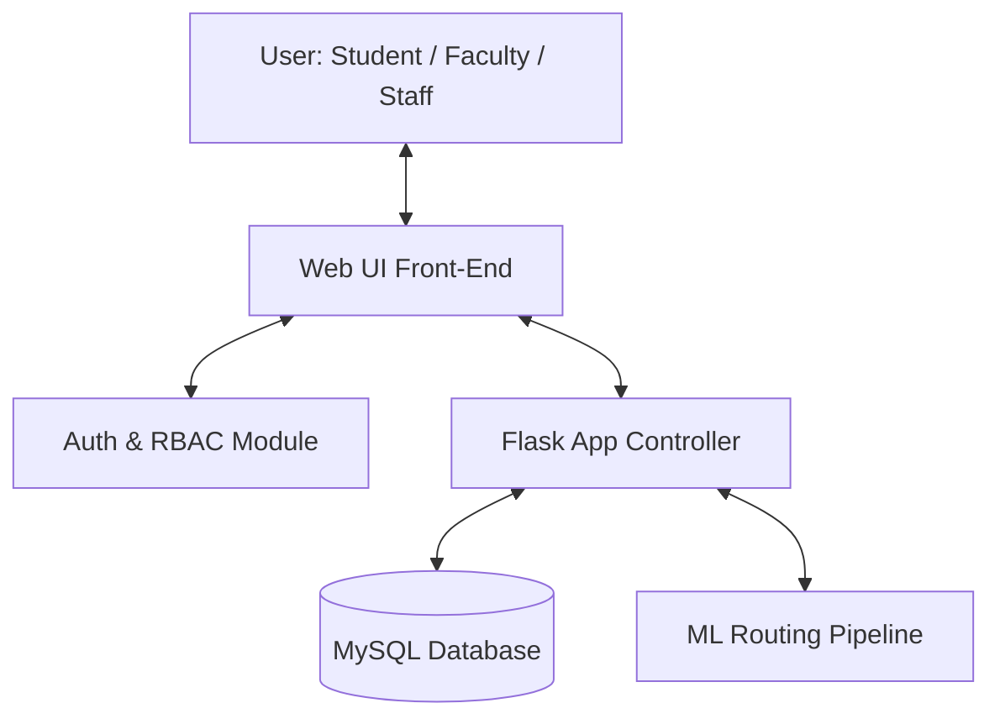

# 🏛️ System Architecture

This document describes the technical architecture, data model, directory structure, and design principles of the **Civic Resolve** platform.

---

## 🏗️ High-Level System Overview

Civic Resolve uses a classic Model-View-Controller (MVC) structure adapted to Flask, integrated with a Machine Learning classification layer for auto-routing tickets.



---

## 📂 Project Directory Structure

Civic-Resolve-Intelligent-Complaint-Routing/
├── .gitignore                       # Git ignore specifications
├── docs/                            # Project documentation markdowns
│   ├── architecture.md              # System architecture & database schema details
│   ├── ml_model.md                  # ML routing model details & thresholds
│   └── setup.md                     # Local system setup & database config instructions
├── media/                           # Project media, poster and presentation decks
│   ├── CivicResolve_A1Poster.pdf    # Project poster
│   ├── CivicResolve_PitchDeck.pptx  # Pitch deck presentation
│   └── gallery/                     # Image gallery (empty)
├── project/                         # Source code directory
│   ├── .env.example                 # Example configuration template file
│   ├── app.py                       # Main application controller & ML routing inference
│   ├── auth.py                      # MySQL-backed session authentication & RBAC middleware
│   ├── model.ipynb                  # ML Model notebook for training, evaluation & export
│   ├── model.pkl                    # Serialized Multinomial Naive Bayes classifier
│   ├── multi_app_launcher.py        # Helper script for running multi-role sessions
│   ├── vectorizer.pkl               # Serialized TF-IDF text vectorizer (1-2 n-grams)
│   ├── data/
│   │   ├── complaints.csv           # Seed data & model training dataset
│   │   ├── users.csv                # Seed user accounts
│   │   └── sql/                     # SQL initialization scripts
│   │       ├── users.sql            # Users schema & CSV import script
│   │       ├── complaints.sql       # Complaints schema & CSV import script
│   │       └── syslogs.sql          # System audit logs schema
│   ├── static/
│   │   └── assets/                  # Project media and UI styling assets
│   │       ├── css/                 # Stylesheets (auth-pages.css, dashboard.css)
│   │       ├── images/              # Branding assets (sau-white-logo.png)
│   │       └── js/                  # Client-side scripts (auth-waves.js, cache-guard.js, dashboard.js)
│   └── templates/
│       ├── dashboard/               # Base layout and role-specific dashboards
│       │   ├── admin/               # Superadmin view (index.html)
│       │   ├── staff/               # Maintenance staff view (index.html)
│       │   ├── users/               # Student/Faculty view (index.html)
│       │   └── base_dashboard.html  # Shared dashboard template
│       ├── invalid-login/           # Error & fallback triage portal (index.html)
│       └── login/                   # Multi-role landing & portal pages
│           ├── maintenance/         # Maintenance staff login page (index.html)
│           ├── users/               # Student/Faculty login page (index.html)
│           └── index.html           # Main role-selection landing page
└── requirements.txt                 # Python dependency specifications
```

---

## 🗄️ Database Schema & Data Models

Civic Resolve operates on three primary relational tables within the `Civic_Resolve` database.

### 1. `Users` Table
Stores account information and assigns access permissions to campus users.
*   `user_id` (VARCHAR(50), Primary Key): Unique identifier (e.g., student ID, staff username).
*   `password` (VARCHAR(255)): Hashed password credentials.
*   `name` (VARCHAR(100)): User's display name.
*   `phone` (VARCHAR(15)): Contact details.
*   `role` (ENUM('student', 'admin', 'staff')): Access level.
*   `wing` (VARCHAR(50)): Assigned wing for maintenance staff (e.g., Electrical, Plumbing); otherwise NULL.

### 2. `Complaints` Table
Tracks all maintenance requests filed through the system.
*   `ticket_id` (VARCHAR(50), Primary Key): Randomly generated UUID.
*   `user_id` (VARCHAR(50), Foreign Key): References `Users.user_id`.
*   `created_at` (DATETIME): Timestamp when the ticket was created.
*   `description` (TEXT): Detailed description of the complaint.
*   `location` (VARCHAR(100)): Campus location details.
*   `wing` (VARCHAR(50)): The category/wing visible to users.
*   `true_wing` (VARCHAR(50)): The internal department wing routing key.
*   `priority` (VARCHAR(20)): Ticket priority level (e.g., Low, Medium, High).
*   `status` (VARCHAR(20)): Current ticket status (e.g., Pending, In Progress, Resolved).
*   `scheduled_timestamp` (DATETIME, Nullable): Time set by staff for resolution.
*   `calibration_timestamp` (DATETIME, Nullable): Time when the ticket was calibrated or assigned.

### 3. `Syslogs` Table
Maintains a chronological record of actions taken on tickets for compliance.
*   `id` (INT, Primary Key, Auto-Increment).
*   `action` (VARCHAR(255)): Log message of the action.
*   `timestamp` (TIMESTAMP): Time of execution.
*   `performed_by` (VARCHAR(50)): ID of the operator.

---

## 🔄 The Dual-Label Routing Strategy

To keep the system flexible and secure, every ticket is stored with two department labels:

1.  **`wing` (Display Label)**: Shown to the submitting student/faculty to represent the ticket's category.
2.  **`true_wing` (Routing Key)**: Used by staff dashboards to filter visible complaints.

> [!NOTE]
> If a ticket is classified with high confidence, `wing` and `true_wing` match (e.g., `Electrical`).
> If a ticket is flagged as **Spam** or **Uncertain**, `true_wing` is set to **`General`**, making it visible on all maintenance dashboards. This allows any available staff member to triage, reassign, or dismiss it.

---

## 🔐 Role-Based Access Control (RBAC)

Access control rules are enforced globally via Flask's `@app.before_request` middleware:

| Role | Access Permissions |
| :--- | :--- |
| **Student / Faculty** | Can view personal dashboards, submit new complaints, and track status. Cannot modify ticket fields. |
| **Maintenance Staff** | Can view active/aging tickets for their assigned `wing` or `General`. Can update status/priority. |
| **Superadmin** | Full cross-wing dashboard access. Can manually reassign and override `true_wing` routing keys for any ticket. |
